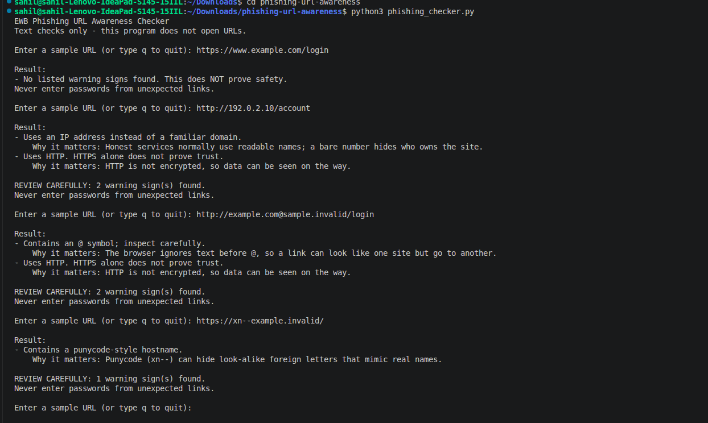
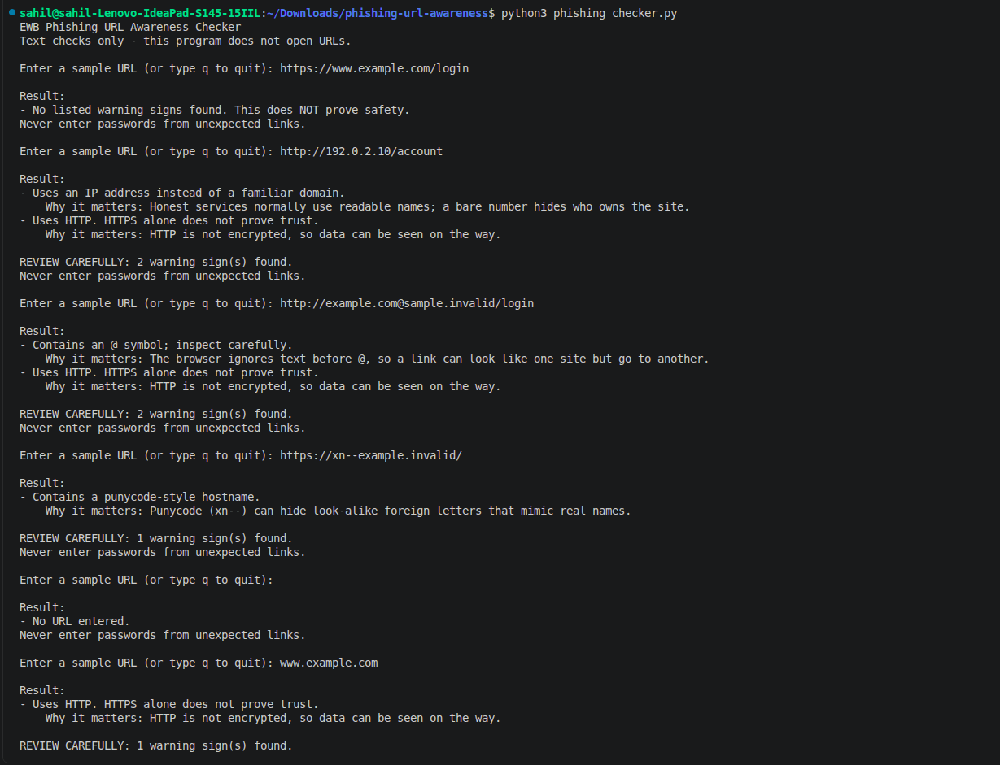

# EWB Phishing URL Awareness Checker

## Overview
Phishing is a trick where attackers send fake links or messages to make people share passwords, card numbers or OTPs. These fake links often look like real ones. This project is a beginner-friendly Python command-line tool that reads the text of a URL and points out six visible warning signs, such as an @ symbol, an IP-address hostname or a punycode marker. It only reads the text and never opens the link, and it can't prove that a URL is safe.

## Features
- Detects an @ symbol in the URL
- Flags unusually long URLs (over 100 characters)
- Flags IP-address hostnames
- Flags many hostname segments (5 or more)
- Flags punycode-style hostnames (xn--)
- Flags the HTTP scheme
- Loop mode: check many URLs, type `q` to quit
- "REVIEW CAREFULLY" summary with a count of warnings
- Safe handling of malformed input (no crashes)
- A one-line "why it matters" explanation under each warning

## Requirements
Python 3.10 or later. No extra packages.

## How to Run
Windows: `python phishing_checker.py`
Mac/Linux: `python3 phishing_checker.py`

## Example Output
Enter a sample URL (or type q to quit): https://www.example.com/login

Result:
- No listed warning signs found. This does NOT prove safety.
Never enter passwords from unexpected links.

## Testing
| # | Input | Expected | Actual | Result |
|---|-------|----------|--------|--------|
| 1 | https://www.example.com/login | No warning signs | No listed warning signs found | PASS |
| 2 | http://192.0.2.10/account | IP address + HTTP | IP address + HTTP flagged | PASS |
| 3 | http://example.com@sample.invalid/login | @ symbol + HTTP | @ symbol + HTTP flagged | PASS |
| 4 | https://a.b.c.d.e.example.invalid/path | Many hostname segments | Many segments flagged | PASS |
| 5 | https://xn--example.invalid/ | Punycode-style hostname | Punycode flagged | PASS |

Full table: `tests/test_samples.md`

## Screenshots

## Improvements
1. Loop with quit - [explain in your words why you added it and how you tested it]
2. Review-carefully summary - [your words]
3. Malformed input handling (try/except) - [your words: `http://[bad` used to crash]
4. Explanations for each warning - [your words]

## Limitations
This is an educational tool. It only reads URL text. It does not visit
URLs, scan for malware or prove that a URL is safe. No warning signs
found does NOT mean a URL is safe.

## Ethical Use
Use sample strings only. Do not collect credentials. Do not use this
project to deceive anyone or to test websites without permission.

## Author
SAHIL SHAHABZ, Cybersecuirty, EWB Courses
